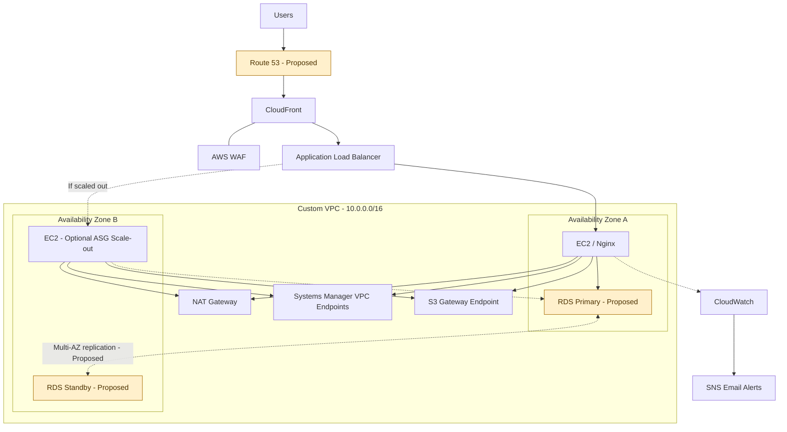

# manara-scalable-web-application-aws
# Scalable Web Application on AWS

## Project Overview

This project demonstrates the design and implementation of a scalable web application architecture on Amazon Web Services (AWS). It covers networking, content delivery, web application security, load balancing, EC2 Auto Scaling, managed databases, and monitoring.

The project was implemented primarily through the AWS Management Console.

## Architecture Diagram

The diagram represents the intended architecture and includes proposed Route 53 DNS integration and an RDS Multi-AZ deployment to demonstrate the target design.

**Implementation status:** Route 53 custom-domain integration and RDS Multi-AZ were not deployed in the current environment. The diagram distinguishes these proposed components from the verified implementation.

## AWS Services

| Service | Purpose |
|---|---|
| Amazon VPC | Isolated network using `10.0.0.0/16` |
| Public and private subnets | Separate internet-facing resources from application and database tiers |
| Internet Gateway | Internet connectivity for public subnet routes |
| NAT Gateway | Outbound internet connectivity for private application instances |
| Amazon EC2 | Runs Amazon Linux 2023 and Nginx |
| EC2 Auto Scaling | Maintains the configured desired capacity and replaces unhealthy instances when conditions permit |
| Application Load Balancer | Routes HTTP requests to registered application instances |
| Amazon CloudFront | Content delivery layer in front of the ALB |
| AWS WAF | Managed web request inspection and rate-based rules |
| Amazon RDS for MySQL | Managed relational database |
| AWS Systems Manager | Session Manager access to EC2 |
| VPC Endpoints | Private connectivity to supported AWS services |
| Amazon CloudWatch | Metrics and alarms |
| Amazon SNS | Email alarm notifications |
| Amazon Route 53 | Proposed custom DNS, alias record, and health-check integration |
  
## Networking and Application Flow

The intended request flow is:

1. Users resolve the application hostname through Route 53.
2. Route 53 directs users to the CloudFront distribution.
3. CloudFront applies the configured web security and caching behavior.
4. The Application Load Balancer forwards application requests to healthy EC2 targets.
5. EC2 instances run Nginx in private application subnets.
6. The application tier accesses the database through restricted security-group rules.

The current deployment uses the default CloudFront domain because a custom domain and Route 53 integration were not configured.

## Compute and Auto Scaling

The launch template `manara-web-launch-template` defines the EC2 configuration and Nginx user data.

The Auto Scaling Group `manara-web-asg` is configured with:

- Minimum capacity: 1
- Desired capacity: 1
- Maximum capacity: 2

The group is associated with the `manara-web-tg` target group and uses load balancer health checks.

A dynamic CPU-based scaling policy was not configured. The group can maintain its desired capacity and replace unhealthy instances when its health checks and configuration permit, but CPU-based scale-out is not enabled.

## CloudFront and AWS WAF

The CloudFront distribution uses the Application Load Balancer as its origin. Viewer HTTP requests are configured to redirect to HTTPS, while the origin connection uses HTTP through the ALB listener on port 80.

The Web ACL `CreatedByCloudFront-2599ba11` includes:

- Rate-based IP rule
- Amazon IP Reputation List
- Common Rule Set
- Known Bad Inputs Rule Set
- SQL Injection Rule Set

These rules were observed in Count mode. Matching requests are counted rather than blocked by these rules in their current mode.

## Database Architecture: Single-AZ Implementation and Multi-AZ Proposal

The deployed database `manara-mysql-db` uses Amazon RDS for MySQL in Single-AZ mode and is not publicly accessible.

The proposed production architecture uses RDS Multi-AZ, with a primary DB instance and a synchronous standby in a separate Availability Zone. This design improves availability and supports managed failover.

**Implementation status:** Multi-AZ was not enabled in the current deployment. The two-AZ DB subnet group alone does not mean that the DB instance is Multi-AZ.

## Route 53: Proposed DNS Integration

The proposed design uses an Amazon Route 53 hosted zone with an alias record pointing to the CloudFront distribution. Route 53 health checks may be configured where appropriate for the selected endpoint and failover design.

**Implementation status:** No custom domain, Route 53 hosted zone, alias record, or Route 53 health check was configured. The current application endpoint is the default CloudFront domain.

## Monitoring and Notifications

The CloudWatch alarm `manara-ec2-high-cpu` monitors average EC2 CPU utilization against a 70% threshold with the configured evaluation periods.

The SNS topic `manara-alerts` provides email notifications through a confirmed subscription.

## Cost Considerations and Future Improvements

The following improvements remain planned:

1. Register a custom domain and configure Route 53 DNS records and suitable health checks.
2. Upgrade RDS to Multi-AZ when the budget permits.
3. Add a CPU-based Auto Scaling policy if dynamic scale-out and scale-in are required.
4. Review WAF Count-mode results and enable blocking for appropriate rules after testing.
5. Monitor AWS resource costs and remove resources that are no longer required.

## Validation Evidence

The `screenshots/` directory contains screenshots captured from the AWS Management Console during implementation and validation. These images document actual resource configurations and observed states.

Proposed architecture components are identified separately and are not presented as deployed resources.

## Conclusion

This project demonstrates a multi-tier AWS web application with private networking, load balancing, EC2 capacity management, content delivery, WAF rules, database services, and monitoring. The proposed architecture also documents how Route 53 and RDS Multi-AZ can be incorporated in a future iteration.
